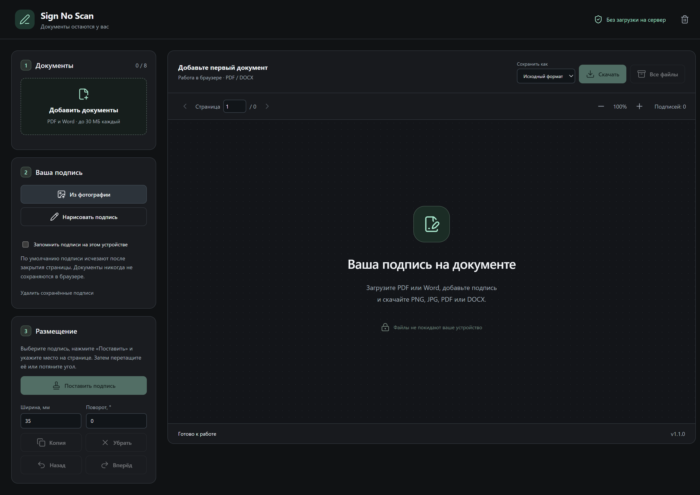

# Sign No Scan

**Подпишите документ без печати и сканирования.** Sign No Scan позволяет добавить рукописную подпись на страницы PDF или Word прямо в браузере: загрузить фотографию подписи или нарисовать её, выбрать место, настроить размер и поворот, затем скачать готовый документ или картинки его страниц.

**[Попробовать онлайн → sign-no-scan.free-now.ru](https://sign-no-scan.free-now.ru/)**

Документы и подписи **не передаются на сайт и не сохраняются на сервере**. Подготовка подписи, размещение и конвертация выполняются в вашем браузере. Сайт раздаёт только интерфейс и локальные библиотеки.



## Возможности

- **Подпись из фото:** загрузка JPG, PNG или WebP, выделение нужного участка, поворот фотографии и регулируемое удаление фона. Цвет исходных чернил сохраняется.
- **Рисование подписи:** мышь, палец или стилус; выбор цвета и толщины линии, очистка рисунка.
- **Размещение на документе:** перемещение подписи, размер в миллиметрах, поворот, копирование и удаление. Подпись можно поставить на нужной странице PDF или DOCX.
- **Конвертация и скачивание:** исходный формат, PDF, Word (.docx), PNG или JPG. Одна страница-картинка скачивается отдельным файлом, несколько — нумерованными картинками в ZIP.
- **Несколько документов:** до 8 файлов одновременно, библиотека до 8 подписей, навигация по страницам и пакетное скачивание подписанных файлов.
- **Удобное редактирование:** масштаб, отмена и повтор действий, перемещение выбранной подписи с клавиатуры.
- **Подписи на своём устройстве:** по желанию их можно запомнить в localStorage браузера и удалить отдельной кнопкой. Без включения этой опции подписи остаются только до закрытия страницы.
- **Локальный и веб-запуск:** приложение можно открыть на PHP-хостинге или запустить на своём компьютере. Обработка документов в обоих случаях остаётся в браузере.

**Технологии:** PHP 8.1+, JavaScript, HTML/CSS и локальные библиотеки. База данных, Composer и сборка Node.js для запуска не нужны.

Текущая версия: **v1.1.0**. Поддерживаются входные **PDF и Word (.docx)**. При PDF → Word страницы становятся картинками без редактируемого текста; при Word → PDF/картинки результат повторяет браузерный предпросмотр. Подробности — в разделе «Форматы скачивания» ниже.

## Быстрый запуск в Windows

1. Распакуйте полный архив в отдельную папку.
2. Если PHP уже установлен или есть XAMPP в `C:\xampp`, откройте `start-local.cmd`.
3. Откроется `http://127.0.0.1:8787`. Для остановки используйте `stop-local.cmd`.

При другом расположении PHP:

```powershell
.\start-local.ps1 -PhpPath 'C:\путь\php.exe' -Port 8787
```

Любая ОС с PHP 8.1+:

```sh
php -d file_uploads=Off -d enable_post_data_reading=Off -S 127.0.0.1:8787 -t public
```

PHP не входит в архив. Composer и Node.js для работы не нужны. Используйте современный Chrome, Edge, Firefox или Safari с поддержкой ES-модулей, Canvas и PDF.js. Файлы `index.php` нельзя открывать двойным щелчком: требуется HTTP-сервер.

## Работа

1. Добавьте до 8 PDF/DOCX.
2. Загрузите JPG/PNG/WebP с подписью. При необходимости выделите только подпись и настройте удаление фона. Можно нарисовать подпись пальцем, мышью или стилусом.
3. Нажмите «Поставить подпись», затем нужное место страницы. Перетащите подпись; размер меняется за угол или через миллиметры. Можно повернуть, скопировать, удалить, отменить и повторить действие.
4. Для следующей страницы используйте навигацию; для другого документа — список слева.
5. В «Сохранить как» выберите исходный формат, PNG, JPG, PDF или Word. «Скачать» сохраняет текущий документ. «Все файлы» скачивает ZIP документов в выбранном формате, в которых есть размещённые подписи. Неподписанные файлы в ZIP не включаются.

Стрелки двигают выбранную подпись на 1 мм; Shift со стрелками — на 5 мм. Delete удаляет, Ctrl/Cmd+Z отменяет, Ctrl/Cmd+Shift+Z повторяет. Escape отменяет постановку подписи.

## Что сохраняется

- Документы, их имена, текст, картинки и координаты подписей находятся в оперативной памяти вкладки. Они не отправляются на сервер и не записываются в localStorage/IndexedDB.
- Сохранённые файлы браузер скачивает на выбранное вами устройство.
- По умолчанию подписи также находятся только в памяти. Галочка «Запомнить подписи» сохраняет только PNG подписей и их размеры в localStorage этого браузера, ключ `signature-studio.v1`.
- «Удалить сохранённые подписи» удаляет этот ключ и библиотеку подписей. Изображения, уже вставленные в открытые документы, остаются до удаления этих документов/подписей или закрытия вкладки.
- «Очистить текущую работу» убирает документы и размещения. Сохранённую библиотеку можно удалить отдельной кнопкой.
- Нет аккаунтов, API загрузки, cookies, PHP-сессий, аналитики, внешних шрифтов и CDN. После загрузки интерфейса вычисления выполняются локально. Веб-сервер может вести обычные журналы запросов к статическим ресурсам; содержимое файлов в эти запросы не включается.
- Локальный запуск отключает PHP-загрузки и автоматический разбор POST. Для PHP-FPM/CGI настройка `public/.user.ini` отключает разбор POST до запуска скрипта; Apache и пример Nginx блокируют методы загрузки на уровне сервера.

Предупреждение браузера при закрытии помогает не потерять работу; после перезагрузки размещения восстановить нельзя.

## Особенности Word

DOCX просматривается в изолированном iframe. Браузерный предпросмотр не является движком Microsoft Word: шрифты, переносы и автоматическое разбиение длинного текста могут различаться. Разбиение использует явные разрывы и сохранённые Word отметки страниц.

Экспорт сохраняет исходный пакет документа и добавляет PNG, relationships и плавающие изображения поверх текста с координатами относительно страницы. Исходный текст, даты, поля, стили и таблицы не переписываются. Перепагинация самим Word всё равно может переместить абзац, к которому привязана подпись.

Если страница не укладывается в размеры листа при просмотре либо на ней нет однозначного абзаца, постановка/экспорт блокируются с объяснением. Для точного совпадения страниц сохраните исходный документ как PDF и загрузите его. Форматы .doc, .docm, документы с паролем и HTML altChunk не поддерживаются.

## Форматы скачивания

| Исходный документ | PNG / JPG | PDF | Word (DOCX) |
|---|---|---|---|
| PDF | Все видимые страницы с подписями, с учётом CropBox и поворота | Исходные элементы и текст сохраняются, добавляется подпись | Каждая страница становится картинкой с подписью; текст не редактируется |
| Word (.docx) | Все страницы браузерного предпросмотра с подписями | Страницы-картинки, повторяющие предпросмотр; текст не выделяется | Исходный пакет с редактируемым текстом и добавленными плавающими подписями |

Одна страница в PNG/JPG скачивается отдельной картинкой. Несколько страниц — ZIP с нумерацией `001`, `002` и далее. JPG сохраняется с качеством 95% и белым фоном. При пакетном сохранении одноимённые файлы получают числовой суффикс.

Для картинок используется до 150 dpi, до 5 мегапикселей и 8192 пикселей по одной стороне; для больших страниц разрешение автоматически уменьшается. Физические размеры страниц в PDF/DOCX сохраняются. Word ограничивает размеры страницы 55,88 см; для большего PDF выберите PDF или картинки. Общий размер изображений/экспортного пакета ограничен 150 МБ. Настройки находятся в `public/assets/js/conversion.js`.

Преобразование Word основано на браузерном предпросмотре, поэтому его переносы и шрифты могут отличаться от Microsoft Word. Проверен Chrome/Chromium на Windows, включая мобильную ширину; экспорт картинок в Firefox и Safari отдельно не проверялся.

## Ограничения

- 8 документов, 30 МБ на файл, 100 МБ суммарно, 100 страниц на документ.
- 8 подписей в библиотеке, фото до 15 МБ / 20 мегапикселей.
- До 200 размещений на документ, 40 состояний отмены.
- DOCX: до 2000 ZIP-частей и 100 МБ после распаковки.
- PDF с паролем не поддерживается. Текст и исходные элементы PDF сохраняются; поверх добавляется изображение подписи.
- Размеры и лимиты: `public/assets/js/core.js`.

## Публикация на PHP-хостинге

1. Назначьте папку `public` корнем отдельного сайта/поддомена либо скопируйте **её содержимое** в отдельную публичную папку существующего сайта.
2. Включите HTTPS. Все файлы `assets`, `docx-frame.html`, `.htaccess` и `.user.ini` должны быть рядом с `index.php`.
3. Не добавляйте аналитические скрипты, загрузчики документов, сторонние CDN и обработчики POST.

Не размещайте утилиту поверх файлов другого проекта. Никакой доступ к БД или папка загрузок не нужны. Каталог `public` может быть доступен процессу PHP только для чтения.

Пример Nginx (домен, корень и сокет PHP замените своими):

```nginx
server {
    listen 443 ssl;
    server_name sign.example.ru;
    root /var/www/signature-studio/public;
    index index.php;
    access_log off;
    # ssl_certificate и ssl_certificate_key берутся из вашего HTTPS-конфига.
    if ($request_method !~ ^(GET|HEAD)$) { return 405; }
    location / { try_files $uri $uri/ =404; }
    location ~ \.php$ {
        try_files $uri =404;
        include fastcgi_params;
        fastcgi_param SCRIPT_FILENAME $document_root$fastcgi_script_name;
        fastcgi_param PHP_VALUE "enable_post_data_reading=Off";
        fastcgi_pass unix:/run/php/php8.2-fpm.sock;
    }
    location ~ \.mjs$ { default_type application/javascript; }
}
```

На Apache ограничения методов и MIME для `.mjs` находятся в `public/.htaccess`. На Nginx/другом сервере MIME для `.mjs` должен быть `application/javascript`.

## Состав

- `public/index.php` — интерфейс, HTTP-заголовки, запрет POST.
- `public/assets/js/app.js` — состояние в памяти, интерфейс и размещение.
- `pdf.js` — просмотр и сохранение PDF с учётом поворота/CropBox.
- `docx.js` — проверка ZIP и точечное добавление OOXML-изображений.
- `docx-frame.js` — изолированный просмотр Word.
- `conversion.js` — локальная конвертация и наложение подписей на картинки.
- `image-docx.js` — Word из подписанных страниц PDF с сохранением размеров.
- `signatures.js` — подготовка фото и рисование.
- `public/assets/vendor` — комплект локальных библиотек и лицензий.
- `tools/package.ps1` — сборка full и update архивов v1.1.0.
- `tests` — проверка экспортов, приватности и браузерного интерфейса на синтетических файлах.

Лицензии и версии сторонних библиотек перечислены в `THIRD_PARTY.md`.
